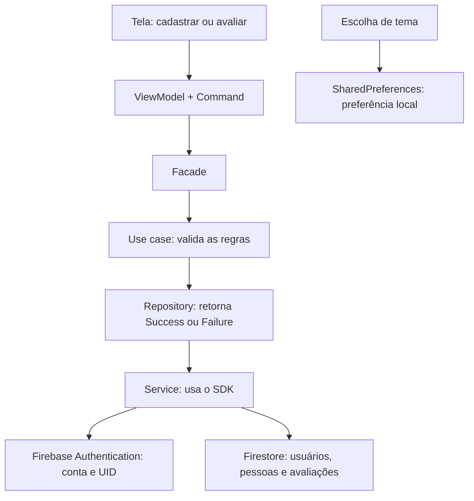

# O que significa cada etapa do guia Firebase

Análise de 05/10/2026 do [Instrucoes_Firebase_PiramidGame.pdf](</home/gabriel/IdeaProjects/atividade_mobile/Instrucoes_Firebase_PiramidGame.pdf>), com conferência do código atual. As páginas citadas são as páginas físicas do PDF, de 1 a 3.

## O que estamos conectando

O Flutter monta as telas e executa a lógica do aplicativo. O Firebase Authentication identifica a conta que está usando o app. O Cloud Firestore guarda os perfis e as avaliações compartilhadas entre dispositivos. O SharedPreferences guarda apenas a escolha de tema deste aparelho.

Há duas ferramentas de terminal diferentes: o Firebase CLI, cujo comando é `firebase`, administra o projeto remoto; o FlutterFire CLI, cujo comando é `flutterfire`, prepara a conexão do projeto Flutter com esse Firebase. Instalar essas ferramentas no computador não as transforma em bibliotecas dentro do app.



A seta mostra o caminho de uma chamada feita pela interface. No PDF da especificação, as camadas também aparecem na ordem inversa, começando em services; é a mesma organização vista do acesso aos dados até a interface.

## Etapa 1 — Criar o projeto e habilitar serviços, página 1

O guia orienta: “Anote o ID do projeto (não apenas o nome).” O projeto Firebase é o agrupamento dos recursos remotos usados pelo aplicativo. O nome de exibição é uma identificação para pessoas; o **Project ID** é o identificador usado pelos comandos e pelos arquivos de conexão. No código atual, ele é `piramidgame`, tanto no [Android e na web][firebase-options] quanto no [arquivo de configuração do CLI][firebase-json].

Em **Authentication > Sign-in method**, habilitar **E-mail/senha** permite criar contas e validar essas credenciais. Habilitar **Google** permite trocar a identidade confirmada pelo Google por uma sessão do Firebase. O e-mail de suporte pertence à configuração do provedor Google; ele não é a senha nem o usuário de login de todas as pessoas do app. As chamadas que usam esses métodos estão em [AuthService][auth-service].

Em **Firestore Database**, criar o banco provisiona o lugar onde o app gravará os documentos. O guia escolhe:

| Configuração | Significado neste projeto |
|---|---|
| Banco `(default)` | Banco padrão. O código usa `FirebaseFirestore.instance`, sem selecionar outro nome de banco. |
| Edição Standard | Edição com a qual o guia e o uso atual do SDK de Firestore estão organizados. |
| Região | Localização do armazenamento remoto. É uma configuração do recurso na nuvem, e não a cidade do usuário ou a linguagem das telas. |
| Modo de produção | Começa com regras que negam leitura e escrita pelos clientes móveis e web. O acesso do app passa a depender das regras publicadas na etapa 4. |

Esse comportamento inicial do modo de produção é documentado pelo [Firebase](https://firebase.google.com/docs/firestore/quickstart). Isso explica por que apenas criar o banco e executar o app ainda pode resultar em “Acesso negado”.

**Coleção** é um agrupamento de documentos, como `pessoas`. **Documento** é um registro identificado por um ID, como `pessoas/abc123`. O Firestore não exige que você crie essas coleções manualmente: as primeiras gravações do [FirestoreService][firestore-service] fazem isso.

O guia diz que Storage e Cloud Functions não são necessários. Isso corresponde ao código: não existe upload de fotos com Firebase Storage, e o ranking é calculado no [caso de uso de ranking][ranking-cases], no aplicativo. Firestore guarda os dados dos quais o ranking é derivado.

## Etapa 2 — Conectar o Flutter, página 1

Execute os comandos do guia na raiz do projeto. São operações distintas:

### `npm install -g firebase-tools`

`npm` é o gerenciador de pacotes do Node.js. `install` baixa e instala um pacote. `-g`, abreviação de `--global`, instala no ambiente global da instalação de Node em uso, permitindo chamar a ferramenta fora da pasta do projeto. `firebase-tools` é o pacote que fornece o comando `firebase`.

Aqui o npm instala uma ferramenta de desenvolvimento. As bibliotecas que o aplicativo Flutter utiliza são declaradas no `pubspec.yaml` e instaladas pelo gerenciador do Dart. A documentação oficial confirma que essa instalação disponibiliza o comando [`firebase`](https://firebase.google.com/docs/cli).

### `firebase login`

Autentica **você, desenvolvedor**, no Firebase CLI, usando sua conta Google e suas permissões sobre os projetos. Essa autenticação permite ao terminal configurar apps e publicar regras. Ela é diferente do login que os usuários fazem na tela do PiramidGame.

Não cria uma conta de aluno e não habilita, sozinha, o provedor Google do aplicativo. O procedimento do terminal é descrito na [referência do CLI](https://firebase.google.com/docs/cli).

### `dart pub global activate flutterfire_cli`

`dart` executa ferramentas do Dart. `pub` gerencia seus pacotes. `global activate` instala e disponibiliza uma ferramenta de terminal globalmente. `flutterfire_cli` é o pacote que fornece o comando `flutterfire`.

O resultado é uma segunda ferramenta: `firebase` cuida do Firebase; `flutterfire` automatiza a ligação com o Flutter. Essa sequência faz parte da [configuração oficial para Flutter](https://firebase.google.com/docs/flutter/setup).

### `flutter pub get`

Lê o [pubspec.yaml][pubspec], resolve as dependências respeitando suas restrições e, quando aplicável, o `pubspec.lock`, baixa os pacotes necessários e prepara os arquivos de resolução de pacotes do Dart. Não cadastra pessoas nem publica regras no servidor.

As principais dependências deste projeto são:

| Dependência | Função no PiramidGame |
|---|---|
| `firebase_core` | Inicializa a conexão com o Firebase. |
| `firebase_auth` | Cadastro, login, sessão e logout. |
| `cloud_firestore` | Leitura e gravação dos dados remotos. |
| `google_sign_in` | Obtenção da identidade Google no fluxo nativo. Na web, o código usa o popup do Firebase Auth. |
| `shared_preferences` | Persistência local do tema. |
| `go_router` | Rotas e redirecionamentos entre telas. |
| `signals_flutter` | Estado reativo observado pelas telas. |

### `flutterfire configure --project=SEU_PROJECT_ID --platforms=android,web`

`configure` prepara a configuração Firebase do aplicativo. `--project=...` seleciona o projeto remoto pelo ID. `SEU_PROJECT_ID` é um exemplo que você deve substituir. `--platforms=android,web` seleciona dois destinos do app, separados por vírgula.

Para o ID presente nos arquivos atuais, o comando correspondente é:

```bash
flutterfire configure --project=piramidgame --platforms=android,web
```

O fluxo registra ou associa os aplicativos de cada plataforma e gera as opções de conexão. A documentação oficial explica a geração de [`lib/firebase_options.dart`](https://firebase.google.com/docs/flutter/setup).

O guia menciona substituir um arquivo de orientação. **No estado atual, esse arquivo já foi substituído por configuração gerada**, com opções Android e web para `piramidgame`. O texto do [README][readme-placeholder] ainda descreve a configuração como pendente. Rodar esse comando novamente faz sentido para atualizar ou mudar a configuração; não é correto assumir que o arquivo atual está vazio.

### `$HOME/.pub-cache/bin` e `PATH`

`$HOME` é a pasta pessoal do usuário. `.pub-cache/bin` é o diretório usual dos executáveis ativados globalmente pelo Pub. `PATH` é a lista de diretórios em que o terminal procura um comando.

Se `flutterfire` estiver instalado mas o terminal não o encontrar, um exemplo de ajuste para a sessão atual de Bash é:

```bash
export PATH="$PATH:$HOME/.pub-cache/bin"
```

`export` disponibiliza a variável aos processos iniciados pelo terminal. `$PATH` mantém os diretórios que já estavam configurados; `:` separa os diretórios; a parte final acrescenta o executável do Pub. Para manter isso em novos terminais, o ajuste precisa existir na configuração do shell.

### Pacote Android e plugin Google Services

`com.example.atividade_mobile` é o **applicationId** Android: a identidade do app instalado. O [Gradle][android-gradle] usa esse valor, e o `google-services.json` presente aponta para o mesmo pacote. Não é o Project ID do Firebase.

O arquivo `android/app/google-services.json` contém a configuração do app Android. O plugin `com.google.gms.google-services` transforma essa configuração em recursos usados no build nativo. Ele está declarado em [settings.gradle.kts][gradle-settings] e aplicado condicionalmente no módulo Android quando o JSON existe. O arquivo gerado deve corresponder ao projeto e ao pacote usados.

### Campos de `firebase_options.dart`

| Campo | O que identifica |
|---|---|
| `projectId` | Projeto Firebase, aqui `piramidgame`. |
| `appId` | App registrado dentro do projeto. Android e web têm IDs diferentes. |
| `apiKey` | Chave de identificação utilizada nas requisições dos SDKs. Não equivale a uma credencial administrativa. |
| `messagingSenderId` | Número do projeto usado na identificação de serviços de mensagens. Sua presença não significa que o app implementou notificações. |
| `authDomain` | Domínio de apoio ao fluxo de autenticação web. |
| `storageBucket` | Nome do bucket associado ao projeto. Sua presença não significa que o app esteja usando Storage. |
| `measurementId` | Identificador associado ao Analytics web. O projeto não declara `firebase_analytics`; o campo gerado não demonstra instrumentação de Analytics no app. |

Os identificadores do arquivo de configuração são descritos como públicos na [documentação de projetos Firebase](https://firebase.google.com/docs/projects/learn-more#config-files-objects). O controle de acesso aos documentos continua dependendo da autenticação e das regras do Firestore.

`DefaultFirebaseOptions.currentPlatform` escolhe as opções da plataforma em execução. Atualmente, o arquivo retorna opções para Android e web e lança `UnsupportedError` para iOS, macOS, Windows e Linux.

Em [main.dart][main], `WidgetsFlutterBinding.ensureInitialized()` prepara o Flutter antes de usar plugins; `await Firebase.initializeApp(options: ...)` inicializa o Firebase com essas opções. Depois são montadas as dependências, carregado o tema e iniciada a interface com `runApp`.

## Etapa 3 — Login Google, página 2

### Os três comandos Android

```bash
cd android
./gradlew signingReport
cd ..
```

`cd android` muda para a pasta do projeto Android. `./gradlew` executa o **Gradle Wrapper** daquela pasta, que seleciona a distribuição de Gradle configurada pelo projeto. O prefixo `./` significa “execute o arquivo daqui”. `signingReport` é a tarefa que mostra informações das assinaturas das variantes do aplicativo. `cd ..` volta para a pasta imediatamente acima, a raiz Flutter.

### SHA-1, SHA-256 e variante debug

Esses valores são impressões digitais do certificado que assina o aplicativo. Eles permitem configurar qual combinação de pacote Android e assinatura está associada ao login Google. Não são senhas de usuário.

**debug** é a variante normalmente instalada por `flutter run` durante desenvolvimento. Uma instalação assinada com outro certificado precisa de seu próprio cadastro. No projeto atual, o build release também usa a configuração de assinatura debug em [build.gradle.kts][android-signing]; um futuro certificado de distribuição deverá corresponder à configuração usada no Firebase.

Depois de habilitar o Google e cadastrar os certificados, o guia manda baixar novamente o JSON porque a configuração de OAuth deve refletir esses ajustes.

### `client_type: 3`, `serverClientId` e `--dart-define`

No JSON Android, um cliente OAuth `client_type: 1` representa a configuração Android; o `client_type: 3` representa o cliente Web usado como identificação do cliente de servidor no fluxo Google. Ter esse cliente Web no JSON pode dispensar passar o `serverClientId` manualmente, conforme a [documentação do plugin Android](https://pub.dev/packages/google_sign_in_android).

O JSON atual possui os dois tipos, e o cliente Android contém uma impressão SHA-1. Isso é evidência da configuração local; não comprova, por si só, o sucesso do login no aparelho nem o cadastro de SHA-256 no console.

O argumento opcional do guia pode ser usado assim:

```bash
flutter run -d SEU_DISPOSITIVO --dart-define=GOOGLE_SERVER_CLIENT_ID=SEU_CLIENT_ID_WEB
```

`-d` seleciona o dispositivo. `--dart-define` disponibiliza uma constante de configuração na compilação Dart. `GOOGLE_SERVER_CLIENT_ID` é o nome que o [AuthService][google-service] lê com `String.fromEnvironment`. `SEU_CLIENT_ID_WEB` deve ser substituído pelo ID OAuth Web, e não pela API key nem pelo Project ID. O uso desse parâmetro não exige criar um servidor próprio.

O código também lê `GOOGLE_CLIENT_ID`, que é uma configuração separada de cliente do fluxo Google nativo. Na web, esses parâmetros não são usados por esse método: a implementação escolhe `FirebaseAuth.signInWithPopup`.

### Domínios autorizados e popup na web

Em **Authentication > Settings > Authorized domains**, o guia pede `localhost` e o domínio de publicação. Essa lista autoriza os domínios que participam do fluxo de autenticação do app web; ela não publica o site.

O botão Google abre um popup. O navegador deve permitir sua abertura. O [AuthService][google-service] utiliza `GoogleAuthProvider` e `signInWithPopup` na web, como descrito no [fluxo oficial de autenticação federada](https://firebase.google.com/docs/auth/flutter/federated-auth).

## Etapa 4 — Publicar as regras, página 2

```bash
firebase deploy --only firestore --project SEU_PROJECT_ID
```

`firebase deploy` envia configuração para o projeto remoto. `--only firestore` seleciona regras e índices do Firestore. `--project` determina o destino. Para a configuração atual, o valor do projeto é `piramidgame`. O alcance desse parâmetro é confirmado na [referência do CLI](https://firebase.google.com/docs/cli).

Isso publica a política de acesso e os índices; não envia as pessoas e avaliações do seu app. É preciso repetir a publicação se você alterar as regras locais e quiser aplicar a nova versão na nuvem. A alternativa pelo console, mencionada no PDF, publica o conteúdo da aba Rules; ela não substitui a publicação de eventuais mudanças de índices.

### Arquivos usados e configurações

| Arquivo ou configuração | Função |
|---|---|
| `firebase.json` → `firestore.rules` | Informa ao CLI qual arquivo contém as regras de acesso. |
| `firebase.json` → `firestore.indexes` | Informa qual arquivo contém a configuração dos índices. |
| `firestore.rules` | Autoriza ou recusa leituras e gravações e valida os campos enviados. |
| `firestore.indexes.json` → `indexes: []` | Não declara índices compostos adicionais. |
| `firestore.indexes.json` → `fieldOverrides: []` | Não declara personalizações de índices de campos. |
| `firebase.json` → `flutter.platforms` | Metadados do FlutterFire sobre projeto, apps e arquivos gerados. As opções utilizadas pelo app ficam no Dart e nos arquivos de plataforma. |
| Ausência de `.firebaserc` | Esta pasta não possui esse arquivo de seleção/aliases do CLI; o guia fornece o destino explicitamente com `--project`. |

Os filtros atuais de [FirestoreService][firestore-queries] são simples: pessoas por `ativo` e avaliações pessoais por `avaliadorUid`. A ordenação dos nomes e dos rankings acontece no Dart; por isso o projeto não declara um índice composto para essas ordenações.

### O significado das regras atuais

| Elemento de `firestore.rules` | Comportamento implementado |
|---|---|
| `rules_version = '2'` | Seleciona a versão da linguagem de regras. |
| `match /databases/{database}/documents` | Define o escopo dos caminhos de documentos. |
| `request.auth != null` | Exige que a requisição tenha uma identidade autenticada. |
| `request.auth.uid` | UID autenticado usado para conferir propriedade e autoria. |
| `request.resource.data` | Conteúdo proposto pela gravação. |
| `resource.data` | Conteúdo atual do documento, usado para comparar atualizações. |
| `hasAll` e `hasOnly` | Exigem todos os campos esperados e impedem campos extras. |
| `validPerson` | Confere campos, curso, ano, nascimento, vínculo, status e datas. |
| `star` e `validScores` | Exigem exatamente os 15 critérios e notas inteiras de 1 a 5. |
| `total` | Soma as 15 notas para verificar `pontuacaoTotal`. |
| `validEvaluation` | Confere identidade, ID do documento, pessoa ativa, vínculo e validade das notas. |
| `request.time` | Hora da requisição no servidor. Datas de controle devem corresponder a ela quando exigido. |
| `allow read/create/update/delete` | Condições específicas de autorização de cada operação. |

Em [`usuarios`][rules-users], só o próprio UID pode ler e gravar o perfil. Em [`pessoas`][rules-people], autenticados podem ler, e somente o criador pode atualizar. Criador e vínculo não podem ser trocados pelo app. Em [`avaliacoes`][rules-evaluations], autenticados podem ler para calcular o ranking global, mas só o autor pode criar ou alterar sua avaliação.

O ID exigido é `UID_PESSOAID`. Uma nova gravação da mesma dupla atualiza o mesmo documento, em vez de gerar votos adicionais. As regras também exigem que o total corresponda à soma das notas.

### `ativo=false`: o que a remoção realmente faz

O [serviço][remove-service] atualiza o status e preserva o documento. As listas consultam somente pessoas ativas, e os rankings também ignoram inativas. O histórico permanece no Firestore. As regras negam exclusão física de pessoas e não permitem reativação pelo app após a desativação.

Essa decisão corresponde ao guia, mas merece conferência com a expressão “exclusão definitiva” na especificação original. A [auditoria][audit] explica essa diferença.

## Etapa 5 — Vincular pessoa e conta, página 2

**UID** é o identificador da conta no Firebase Authentication. Uma pessoa cadastrada para ser avaliada tem outro identificador, o ID do documento em `pessoas`. A conta e o perfil avaliado são registros separados.

| Campo | Pergunta que ele responde |
|---|---|
| `criadoPor` | Quem cadastrou o perfil e tem permissão para editá-lo/removê-lo? |
| `usuarioUid` | Qual conta representa a própria pessoa deste perfil? |

Cadastrar outra pessoa não deve torná-la sua própria identidade: por isso `criadoPor` não é usado como critério de autoavaliação.

Ao marcar **“Este é meu perfil”**, a [tela de cadastro][self-form] envia seu UID em `usuarioUid`. Sem a marcação, envia `null`, indicando que o perfil não está vinculado a uma conta. A [regra de negócio][save-evaluation] e a [regra do Firestore][rules-evaluation-validation] comparam esse campo com o UID do avaliador.

Para uma pessoa já existente, o guia propõe uma operação administrativa: copiar o UID em Authentication > Users e gravá-lo como string no documento correto em `pessoas`. O responsável precisa conferir a identidade para evitar associar a conta à pessoa errada. A edição comum do app não permite modificar esse vínculo.

O próprio guia reconhece: “sem a associação, o sistema não tem como reconhecer que uma conta representa aquela pessoa.” **Logo, o bloqueio é condicionado ao vínculo.** Um usuário pode cadastrar seu perfil sem marcar a opção e avaliá-lo. Reproduzi a aceitação com `usuarioUid=null` tanto no caso de uso quanto no emulador oficial das regras; com o UID correto, o emulador bloqueou a gravação.

## Etapa 6 — Executar e conferir, página 3

### Comandos para iniciar

`flutter run` compila e inicia o app em um dispositivo disponível, com ferramentas de desenvolvimento. Se houver vários destinos, pode pedir a seleção. `flutter run -d chrome` seleciona explicitamente o Chrome e executa a versão web. A linha `# Para testar no navegador:` é um comentário, não um comando.

Neste projeto, os destinos Firebase configurados são Android e web. Em um computador Linux, selecionar Chrome ou um Android configurado evita escolher um destino Linux para o qual `firebase_options.dart` lança erro.

### Coleções e campos para conferir

| Caminho | Conteúdo e finalidade |
|---|---|
| `usuarios/{uid}` | `nome`, `email`, `foto`, `provider`: perfil da conta autenticada. A senha não é salva aqui. |
| `pessoas/{id}` | `nome`, `apelido`, `curso`, `turmaAno`, `dataNascimento`: cadastro básico. |
| Campos de controle em `pessoas` | `criadoPor`, `usuarioUid`, `ativo`, `criadoEm`, `atualizadoEm`: propriedade, vínculo, visibilidade e datas. |
| `avaliacoes/{uid}_{pessoaId}` | `avaliadorUid`, `pessoaId`, mapa `notas`, `pontuacaoTotal`, `dataAvaliacao`, `atualizadoEm`: opinião única daquela conta sobre aquela pessoa. |

`provider` distingue, por exemplo, `password` e `google.com`. `foto` é a URL do perfil fornecida pela autenticação, quando disponível. `notas` é um mapa com os 15 IDs dos critérios e valores inteiros. `pontuacaoTotal` é calculada pelo modelo; não é um número livre que o usuário digita.

O serviço usa `FieldValue.serverTimestamp()` para registrar datas de controle pelo servidor. Na edição de uma avaliação, mantém a data original e atualiza `atualizadoEm`.

### O que cada teste manual verifica

| Ação sugerida pelo guia | O que ela deve demonstrar |
|---|---|
| Criar conta | Conta no Authentication e perfil correspondente em `usuarios`. |
| Cadastrar duas pessoas | Documentos em `pessoas`, sem criar contas de autenticação para elas. |
| Avaliar | Um documento com os 15 critérios e total válido, entre 15 e 75. |
| Fechar e reabrir | Recuperação da sessão e manutenção dos dados remotos. |
| Sair | Logout e redirecionamento para login; dados da interface da sessão anterior são limpos. |
| Entrar com Google | Fluxo Google real e integração com Firebase Auth. |
| Editar avaliação | Atualização da mesma dupla usuário/pessoa, mantendo um único documento. |
| Alternar tema | Alteração imediata e preferência local persistida. |
| Usar duas contas | Ranking pessoal isolado por UID e ranking global calculado com ambas. |
| Usar outro aparelho | Leitura dos mesmos documentos remotos com a mesma conta. |
| Avaliar perfil vinculado à própria conta | Bloqueio na UI, no caso de uso, no serviço e nas regras. |

Por exemplo: se Alice dá 60 e Bob dá 75 a Ana, Alice vê 60 no ranking pessoal e o global mostra `(60 + 75) / 2 = 67,5`, com 2 avaliações. Quando Alice altera sua nota, o divisor continua 2.

O Firebase SDK oferece persistência de autenticação entre reinícios; a senha não precisa ser guardada em SharedPreferences. Isso é documentado em [Firebase Authentication para Flutter](https://firebase.google.com/docs/auth/flutter/start). A auditoria encontrou uma fragilidade adicional do projeto: uma falha ao salvar o perfil no Firestore pode fazer a ViewModel considerar ausente uma sessão Auth válida.

### Emuladores e comandos de verificação presentes no projeto

Os emuladores declarados em [firebase.json][firebase-json] usam Firestore na porta `8080`, Authentication na `9099` e interface de inspeção na `4000`. `singleProjectMode: true` indica o uso de um único projeto na sessão de emulação. Nos testes atuais, é iniciado somente o emulador Firestore.

Essa configuração **não altera automaticamente o destino do app**: `main.dart` não chama `useFirestoreEmulator` nem `useAuthEmulator`. O app executado normalmente utiliza o projeto configurado; a suíte de regras utiliza `demo-piramidgame`, separado dos dados remotos.

| Comando de verificação | Significado |
|---|---|
| `flutter analyze --no-pub` | Faz análise estática do código usando as dependências já resolvidas. `--no-pub` evita a etapa automática de `pub get`. |
| `flutter test --no-pub` | Executa os testes Flutter existentes. |
| `npm --prefix firebase-tests ci` | Instala as dependências da pasta de testes conforme seu `package-lock.json`; `--prefix` seleciona a pasta. Não foi necessário executá-lo nesta análise porque as dependências já estavam presentes. |
| `npm --prefix firebase-tests test` | Executa o script `test` daquele package.json, que inicia o emulador, testa as regras e encerra o emulador. |

O [script de teste][rules-package] usa `emulators:exec` para executar um comando com os emuladores disponíveis; `--only firestore` inicia somente esse serviço; `--project demo-piramidgame` usa o projeto de demonstração; `node --test` executa os testes JavaScript.

Nesta análise, `flutter analyze` não encontrou problemas; os 20 testes Flutter existentes e os 12 testes de regras existentes passaram. Também executei duas reproduções Flutter temporárias e uma reprodução no emulador para conferir as ressalvas de autoavaliação e sessão.

## Diagnóstico de erros citado na página 3

| Sintoma | Significado e conferência |
|---|---|
| “Configure a conexão” | A inicialização falhou. Confira o erro exibido e a plataforma; a [tela de orientação][setup-page] recebe qualquer erro capturado na inicialização, não apenas falta de configuração. |
| “Acesso negado” | Uma operação foi recusada. Confira sessão, projeto e regras publicadas; também pode ser uma tentativa legítima de operação proibida, como editar uma pessoa de outro criador. |
| Falha Google Android | Compare applicationId, assinatura e configuração OAuth do JSON com a instalação em uso. |
| `serverClientId must be provided` | Falta a configuração de cliente de servidor reconhecida pelo plugin; confira o cliente Web de tipo 3 ou o parâmetro opcional. |
| `unauthorized-domain` | O domínio usado no fluxo web não está autorizado no projeto Firebase. |
| Lista/ranking antigos | O código usa consultas ao carregar e ao atualizar as telas. Não usa listeners contínuos de documentos; execute a atualização. Signals torna a UI reativa ao estado carregado, mas não inicia sozinho uma nova consulta ao servidor. |

## iOS opcional, página 3

`flutterfire configure --project=piramidgame --platforms=android,web,ios` acrescenta iOS às plataformas selecionadas. No projeto, o Bundle ID é `com.example.atividadeMobile`; ele identifica o app Apple e difere do pacote Android. O alvo mínimo está definido como iOS 15 no projeto Xcode.

Para o Google, o guia pede:

| Configuração | Finalidade |
|---|---|
| `GoogleService-Info.plist` | Arquivo de configuração fornecido pelo Firebase para o app Apple. Sua integração deve seguir o FlutterFire e o plugin utilizados. |
| `GIDClientID` em `ios/Runner/Info.plist` | Identifica o cliente Google do app iOS, a partir do `CLIENT_ID`. |
| `CFBundleURLTypes` | Registra os esquemas de URL reconhecidos pelo aplicativo. |
| URL scheme derivada de `REVERSED_CLIENT_ID` | Permite o retorno do fluxo Google ao aplicativo. |

Esses campos são explicados na [documentação do plugin iOS](https://pub.dev/packages/google_sign_in_ios). **O iOS ainda não está configurado nos arquivos atuais**: falta sua opção em `firebase_options.dart`, e o `Info.plist` não contém `GIDClientID` nem a URL scheme Google. A especificação não exige explicitamente entrega para iOS; o guia apresenta essa plataforma como opcional.

[firebase-options]: /home/gabriel/IdeaProjects/atividade_mobile/lib/firebase_options.dart:52
[firebase-json]: /home/gabriel/IdeaProjects/atividade_mobile/firebase.json:1
[auth-service]: /home/gabriel/IdeaProjects/atividade_mobile/lib/data/services/auth_service.dart:19
[firestore-service]: /home/gabriel/IdeaProjects/atividade_mobile/lib/data/services/firestore_service.dart:17
[ranking-cases]: /home/gabriel/IdeaProjects/atividade_mobile/lib/domain/use_cases/ranking_use_cases.dart:64
[pubspec]: /home/gabriel/IdeaProjects/atividade_mobile/pubspec.yaml:30
[readme-placeholder]: /home/gabriel/IdeaProjects/atividade_mobile/README.md:19
[android-gradle]: /home/gabriel/IdeaProjects/atividade_mobile/android/app/build.gradle.kts:8
[gradle-settings]: /home/gabriel/IdeaProjects/atividade_mobile/android/settings.gradle.kts:20
[main]: /home/gabriel/IdeaProjects/atividade_mobile/lib/main.dart:18
[android-signing]: /home/gabriel/IdeaProjects/atividade_mobile/android/app/build.gradle.kts:38
[google-service]: /home/gabriel/IdeaProjects/atividade_mobile/lib/data/services/auth_service.dart:35
[firestore-queries]: /home/gabriel/IdeaProjects/atividade_mobile/lib/data/services/firestore_service.dart:26
[rules-users]: /home/gabriel/IdeaProjects/atividade_mobile/firestore.rules:85
[rules-people]: /home/gabriel/IdeaProjects/atividade_mobile/firestore.rules:98
[rules-evaluations]: /home/gabriel/IdeaProjects/atividade_mobile/firestore.rules:114
[rules-evaluation-validation]: /home/gabriel/IdeaProjects/atividade_mobile/firestore.rules:69
[remove-service]: /home/gabriel/IdeaProjects/atividade_mobile/lib/data/services/firestore_service.dart:80
[self-form]: /home/gabriel/IdeaProjects/atividade_mobile/lib/presentation/pages/student_form_page.dart:97
[save-evaluation]: /home/gabriel/IdeaProjects/atividade_mobile/lib/domain/use_cases/evaluation_use_cases.dart:13
[setup-page]: /home/gabriel/IdeaProjects/atividade_mobile/lib/presentation/pages/firebase_setup_page.dart:1
[rules-package]: /home/gabriel/IdeaProjects/atividade_mobile/firebase-tests/package.json:5
[audit]: /home/gabriel/IdeaProjects/atividade_mobile/docs/AUDITORIA_ESPECIFICACAO_FIREBASE.md
